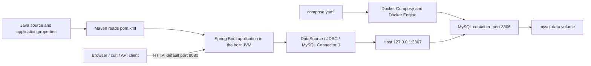

# Dummy API: what this repository does and how the pieces connect

This repository is the starting point for a Java web API backed by MySQL. It contains a Spring Boot application, Maven build configuration, a Docker Compose definition for MySQL, database connection settings, and a basic startup test.

The application is currently a **starter project**: there are no custom API endpoints, business services, JPA entities, repository interfaces, or database migration scripts. The database is named `shop`, but no shop features have been implemented. The dependencies provide the infrastructure for adding those features.

This guide describes the files currently in the repository. Examples of future API behavior are explicitly labeled. The run commands are instructions; they were not executed while writing this guide.

## 1. What each tool is responsible for

| Piece | What it does | Its role in this repository |
| --- | --- | --- |
| **Git** | Records changes to files and supports branches and collaboration. | Would track the source code, build settings, Compose file, and migrations in a normal Git checkout. |
| **Java / JDK / JVM** | Java is the language; the JDK provides development tools; the JVM executes compiled Java code. | The project targets Java **21**. The application runs as a JVM process. |
| **Maven (`mvn`)** | Resolves dependencies, compiles code, runs tests, and packages the application. | Reads `pom.xml` and writes build output into `target/`. |
| **Maven Wrapper (`mvnw`)** | Downloads and invokes a project-selected Maven distribution. | The wrapper configuration selects Maven **3.10.0**; the wrapper scripts are version **3.3.4**. |
| **Spring Framework** | Creates and connects application objects and provides web, database, and transaction support. | Supplies the underlying framework used by Spring Boot and the Spring starters. |
| **Spring Boot** | Starts the application and configures infrastructure from dependencies and settings. | The parent in `pom.xml` is Spring Boot **4.1.1**. |
| **Spring MVC / embedded web server** | Accepts HTTP requests and routes them to controller methods. | The web MVC starter supplies web infrastructure; custom controllers have not been added. |
| **Docker** | Runs software in containers created from images. | Runs the MySQL server from the `mysql:8.4` image. |
| **Docker Compose** | Defines and manages containers, port mappings, and volumes. | Reads `compose.yaml`, which defines one service: `mysql`. |
| **MySQL** | Stores data in tables and executes SQL statements. | Hosts the `shop` database inside the Docker container. |
| **JDBC** | Defines Java interfaces for connecting to SQL databases and executing SQL. | Provides the database access foundation beneath JPA/Hibernate and Flyway. |
| **MySQL Connector/J** | Implements JDBC for MySQL. | The `mysql-connector-j` dependency lets Java communicate with the MySQL server. |
| **Spring Data JPA / Hibernate** | Provides repositories and maps Java objects to relational data. | Included through the JPA starter; application entities and repositories are still to be written. |
| **DataSource / HikariCP** | Supplies database connections and pools them for reuse. | Spring Boot can configure the pool using the project's `spring.datasource.*` settings. |
| **Flyway** | Applies versioned database schema migrations. | The Flyway starter and MySQL support module are present, but no migrations exist yet. |
| **Validation** | Checks annotated values, such as required fields or minimum lengths. | The validation starter is present; no request models or validation rules exist yet. |
| **JUnit / Spring Boot testing / Testcontainers** | Runs tests and can provide temporary containerized dependencies. | There is a startup test. The Testcontainers configuration is currently empty. |

## 2. The overall layout

There are two main runtime processes in the current development setup:

1. The **Java application runs on your machine**, started through Maven, an IDE, or `java -jar`.
2. The **MySQL server runs inside a Docker container**, started through Docker Compose.



The HTTP arrow represents the web server infrastructure. It does not imply that a custom route such as `/products` already exists.

There is no Dockerfile or application service in `compose.yaml`. Running `docker compose up` starts the database service defined there; it does not compile or launch the Java application.

Git records the files used to build and configure this setup. Maven prepares and launches the Java side. Docker prepares the database side. The application then connects to MySQL over a network connection.

## 3. Where to look in the repository

```text
Dummy-API/
├── README.md                         This explanation
├── pom.xml                           Dependencies, Java version, build plugin
├── mvnw                              Maven Wrapper for Linux/macOS
├── mvnw.cmd                          Maven Wrapper for Windows
├── .mvn/wrapper/
│   └── maven-wrapper.properties       Selected Maven distribution
├── compose.yaml                      MySQL container configuration
├── .gitignore                        Files Git should normally ignore
├── .gitattributes                    Wrapper script line-ending rules
├── HELP.md                           Generated getting-started notes
├── src/main/java/com/example/demo/
│   └── DemoApplication.java          Application entry point
├── src/main/resources/
│   └── application.properties        Application and database settings
├── src/test/java/com/example/demo/
│   ├── DemoApplicationTests.java     Application-context startup test
│   ├── TestDemoApplication.java      Development launcher with test config
│   └── TestcontainersConfiguration.java
│                                     Empty test configuration
└── target/                           Generated build output, when built
```

`src/main` contains application code and resources. `src/test` contains testing code. `target/` contains generated output such as compiled classes, test reports, and packaged JARs; edit the source files rather than generated copies.

The existing `HELP.md` contains outdated generated statements that no Compose services were found. The current `compose.yaml` does define MySQL. It also describes Testcontainers support without any actual container declarations. Use the current configuration and code to establish what is implemented.

## 4. Maven: how the application gets its libraries and becomes runnable

Maven reads [pom.xml](pom.xml), the Project Object Model. The project coordinates are:

```text
groupId:    com.example
artifactId: demo
version:    0.0.1-SNAPSHOT
```

These identify the build artifact. `SNAPSHOT` denotes a development version. With the current settings, packaging produces `target/demo-0.0.1-SNAPSHOT.jar`.

The Spring Boot parent manages dependency versions and build defaults. A **starter** is a dependency that brings in a group of related libraries. For example, the JPA starter brings database persistence infrastructure through transitive dependencies, which are libraries required by another dependency.

The main dependencies connect to application features as follows:

| Dependency in `pom.xml` | Purpose |
| --- | --- |
| `spring-boot-starter-webmvc` | HTTP handling with Spring MVC. |
| `spring-boot-starter-data-jpa` | Spring Data JPA, Hibernate, and related persistence infrastructure. |
| `spring-boot-starter-flyway` | Spring Boot integration for Flyway migrations. |
| `flyway-mysql` | Flyway support for MySQL. |
| `spring-boot-starter-validation` | Bean Validation support for annotated constraints. |
| `mysql-connector-j` | The MySQL JDBC driver. |
| `spring-boot-docker-compose` | Optional development integration with Docker Compose; disabled in this project's settings. |
| The `*-test` starters | Test support for the corresponding application features. |
| `spring-boot-testcontainers` and `testcontainers-junit-jupiter` | Integration for declaring and managing containers in tests. |

Dependencies without an explicit scope use Maven's default `compile` scope. `runtime` dependencies are available when the application runs. `test` dependencies are for compiling and running tests and are excluded from the normal application artifact. The Compose dependency's `optional` flag controls dependency propagation to projects that depend on this project; the explicit application property is what disables Compose integration here.

The `spring-boot-maven-plugin` supports launching the application and repackaging it as an executable JAR containing its runtime libraries.

### `mvn` versus `./mvnw`

`mvn` invokes Maven installed on your machine. `./mvnw` invokes the project wrapper, using the distribution selected in [.mvn/wrapper/maven-wrapper.properties](.mvn/wrapper/maven-wrapper.properties). This makes the build command more consistent across developers. You still need a JDK; the wrapper supplies Maven, not Java. Its first use may require network access to download Maven. See the [Maven Wrapper documentation](https://maven.apache.org/tools/wrapper/).

Useful commands, run from this directory:

| Command | Result |
| --- | --- |
| `./mvnw compile` | Compiles application code. |
| `./mvnw test` | Compiles and runs tests. |
| `./mvnw package` | Compiles, runs tests, and packages a JAR. |
| `./mvnw clean package` | Removes previous build output, then builds a JAR. |
| `./mvnw spring-boot:run` | Launches the application through the Spring Boot plugin. |
| `./mvnw dependency:tree` | Shows direct and transitive dependencies. |

Maven lifecycle phases execute earlier phases as needed: `package` includes `test`, which includes compilation. `clean` removes build output; it does not erase the Docker database volume. See the [Maven build lifecycle](https://maven.apache.org/guides/introduction/introduction-to-the-lifecycle.html).

Because the current test starts the application with its database configuration, `test` and `package` need the configured MySQL server to be available. Plain `compile` does not start the application.

## 5. Spring Boot: what happens when Java starts

[DemoApplication.java](src/main/java/com/example/demo/DemoApplication.java) contains the entry point:

```java
@SpringBootApplication
public class DemoApplication {
    public static void main(String[] args) {
        SpringApplication.run(DemoApplication.class, args);
    }
}
```

`@SpringBootApplication` enables configuration, auto-configuration, and component scanning. Spring searches the application's package and its subpackages for components such as controllers and services. It creates managed objects called **beans** and connects their dependencies. For example, a future service can receive a repository through its constructor. See [Spring Boot's application annotation](https://docs.spring.io/spring-boot/reference/using/using-the-springbootapplication-annotation.html).

Based on the dependencies and properties in this project, the expected startup behavior is to load settings, configure database access and Flyway/JPA infrastructure, and start the embedded servlet web server. Successful startup requires the database connection to work.

The web MVC starter supplies Spring MVC and, by default, embedded Tomcat. No separate Tomcat installation is needed. With no `server.port` override, the normal HTTP port is `8080`. Controllers would define routes and return responses such as JSON; there are no such controllers yet. See [Spring Boot servlet web applications](https://docs.spring.io/spring-boot/reference/web/servlet.html).

`spring.application.name=demo` names the application. It does not create a URL route or change the database name.

## 6. Docker Compose and MySQL: how the database starts and persists

[compose.yaml](compose.yaml) defines the `mysql` service using the `mysql:8.4` image. An **image** is the software template; a **container** is a running instance created from it.

On initialization of an empty database data directory, the configured environment variables establish:

| Compose variable | Value | Meaning |
| --- | --- | --- |
| `MYSQL_DATABASE` | `shop` | Creates the application database. |
| `MYSQL_USER` | `shop` | Creates the application database user. |
| `MYSQL_PASSWORD` | `shop_password` | Sets that user's password. |
| `MYSQL_ROOT_PASSWORD` | `root_password` | Sets the database administrator's password. |

The application connects as `shop`. The health check uses `root` inside the container.

These initialization settings apply to a new data directory. Editing the environment variables does not automatically change users or passwords in an already initialized database volume. See [MySQL container initialization and persistence](https://dev.mysql.com/doc/refman/8.4/en/docker-mysql-more-topics.html).

### Why there are two database ports

The port mapping is:

```yaml
ports:
  - "127.0.0.1:3307:3306"
```

Read it as **host address : host port : container port**:

- `127.0.0.1` binds the published port to the host's loopback address.
- `3307` is the port the host application connects to.
- `3306` is the port where MySQL listens inside its container.

The host application therefore uses `127.0.0.1:3307`. If an application service were later added to the same Compose network, it would normally connect using the service name and internal port, `mysql:3306`. Inside that application container, `127.0.0.1` would refer to the application container itself. See [Docker's Compose application model](https://docs.docker.com/compose/intro/compose-application-model/).

### Where the data lives

```yaml
volumes:
  - mysql-data:/var/lib/mysql
```

`mysql-data` is a named Docker volume mounted at MySQL's data directory. Docker normally prefixes the volume name with the Compose project name. Database files survive container removal and ordinary `docker compose down` operations. They are stored in Docker-managed storage, outside the Java source tree. See [Compose named volumes](https://docs.docker.com/compose/gettingstarted/).

`docker compose down -v` removes the declared named volume as well, deleting this database's persisted data. Ordinary `docker compose down` preserves it. See the [Compose down reference](https://docs.docker.com/reference/cli/docker/compose/down/).

### What the health check means

The health check runs `mysqladmin ping` inside the container every five seconds, with a five-second timeout and twenty retries. It checks whether the MySQL server responds; it does not test the Java application's connection or any future API route.

The application settings include:

```properties
spring.docker.compose.enabled=false
```

Although the Spring Boot Compose dependency is present, automatic Compose integration is explicitly disabled. Start MySQL yourself before launching the application. See [Spring Boot development-time services](https://docs.spring.io/spring-boot/reference/features/dev-services.html).

## 7. JDBC, the driver, and the connection pool

[application.properties](src/main/resources/application.properties) specifies:

```properties
spring.application.name=demo
spring.docker.compose.enabled=false
spring.datasource.url=jdbc:mysql://127.0.0.1:3307/shop
spring.datasource.username=shop
spring.datasource.password=shop_password
```

The URL breaks down as follows:

| Part | Meaning |
| --- | --- |
| `jdbc:` | A Java JDBC connection URL. |
| `mysql:` | A connection intended for a MySQL JDBC driver. |
| `127.0.0.1` | The host where the database port is published. |
| `3307` | The published host port from Compose. |
| `/shop` | The database to use. |

**JDBC is a Java API**, with interfaces such as `Connection`, `PreparedStatement`, and `ResultSet`. Java database libraries use it to submit SQL and read results. See the [Java 21 JDBC API](https://docs.oracle.com/en/java/javase/21/docs/api/java.sql/java/sql/package-summary.html).

**MySQL Connector/J is the JDBC driver** that implements those interfaces for MySQL and communicates using MySQL's network protocol. It must be available even when your code uses JPA rather than writing direct JDBC calls. See [MySQL Connector/J](https://dev.mysql.com/doc/connector-j/en/connector-j-overview.html).

**A DataSource supplies connections.** With this project's JPA starter, Spring Boot normally selects HikariCP to maintain a pool of reusable connections. Boot can infer the driver from the URL when the driver dependency is available, so this configuration does not need an explicit driver class. See [Spring Boot DataSource configuration](https://docs.spring.io/spring-boot/reference/data/sql.html#data.sql.datasource).

The configuration must agree across both sides: Compose initializes a `shop` database and user, and Spring's properties select that database and authenticate as that user. Docker does not directly inject these Spring properties; the files currently contain matching values.

## 8. JPA, Hibernate, and Spring Data: the layers above JDBC

These three names describe different responsibilities:

- **JPA**, now Jakarta Persistence, defines how Java objects are mapped to relational data.
- **Hibernate** implements JPA and handles persistence operations and SQL generation.
- **Spring Data JPA** provides repository support, including implementations of interfaces you define.

A future repository might extend `JpaRepository<Product, Long>` to provide operations such as saving products or finding them by ID. A future `Product` class annotated with `@Entity` would describe its table mapping. Neither exists in this repository yet. See [Spring Data repository concepts](https://docs.spring.io/spring-data/jpa/reference/repositories/core-concepts.html).

For an ordinary repository operation, the conceptual path is:

```text
Application service
  → Spring Data JPA repository
  → JPA / Hibernate
  → JDBC connection supplied by the DataSource/pool
  → MySQL Connector/J
  → MySQL server
```

Results return through those layers and are mapped into Java objects. JPA does not replace the driver or database connection. Direct JDBC access would use the connection layer without going through Hibernate. The application currently uses the JPA starter rather than the separate Spring Data JDBC starter. See [Spring Boot SQL and JPA support](https://docs.spring.io/spring-boot/reference/data/sql.html#data.sql.jpa-and-spring-data).

Spring transaction support can group multiple database operations into a unit that commits or rolls back together, commonly using `@Transactional` on a service method. There are no application transaction methods yet.

## 9. Flyway: how database structure can evolve with the code

Flyway is included through `spring-boot-starter-flyway` and `flyway-mysql`. It uses the application's database connection by default and applies pending migrations during startup.

Its default migration location would be:

```text
src/main/resources/db/migration/
```

An illustrative first migration filename is `V1__create_products.sql`, with two underscores between the version and description. No such file or migration directory currently exists. Flyway records applied migrations in a schema history table. With this MySQL setup and no `ddl-auto` override, Hibernate's default schema-generation mode is `none`; adding an entity alone does not create its business table. See [Spring Boot database initialization](https://docs.spring.io/spring-boot/how-to/data-initialization.html).

The responsibilities fit together this way:

```text
Git versions a migration SQL file with the application code.
Maven packages that resource with the application.
Flyway applies the migration to MySQL when the application starts.
MySQL stores the schema, rows, and migration history in its data directory.
Docker's named volume preserves that data directory across container replacement.
```

Creating the `shop` database through Compose initializes the database container. Creating a `products` table through a migration would define part of the application's schema. These are separate steps.

## 10. What a future API request would do

The following example explains how the available technologies could cooperate after product features are implemented. **`POST /products` does not exist yet.**

1. An API client sends an HTTP request containing JSON to `http://localhost:8080/products`.
2. Embedded Tomcat and Spring MVC route the request to a controller.
3. The controller receives the request data; validation can check constraints before processing.
4. A service applies business rules and coordinates a transaction.
5. A Spring Data repository delegates a save operation to Hibernate.
6. Hibernate executes SQL through JDBC, the connection pool, and the MySQL driver. The network connection reaches host port `3307`, which forwards to MySQL's container port `3306`.
7. MySQL stores the row, and the application returns an HTTP response, commonly JSON.

Git and Maven participate in preparing the code and its build. They are not involved in processing each HTTP request. Flyway handles migrations during startup rather than handling individual product requests.

## 11. What the current tests actually test

[DemoApplicationTests.java](src/test/java/com/example/demo/DemoApplicationTests.java) uses `@SpringBootTest` and contains an empty `contextLoads()` test method. The test succeeds if Spring can start the application context. It can fail because of configuration or database startup errors, even though the method has no assertions.

It does not currently verify API responses, business rules, or database CRUD behavior. `@SpringBootTest` uses a mock web environment by default, so this test does not require a real HTTP listener on port `8080`. See [testing Spring Boot applications](https://docs.spring.io/spring-boot/reference/testing/spring-boot-applications.html).

The test imports [TestcontainersConfiguration.java](src/test/java/com/example/demo/TestcontainersConfiguration.java), but that class declares no container beans or connection overrides. Having Testcontainers dependencies installed does not create a temporary MySQL instance by itself.

Consequently, with the checked-in settings and no external overrides, the startup test uses the same configured `shop` database at `127.0.0.1:3307` as the application. There is no separate test database configuration.

[TestDemoApplication.java](src/test/java/com/example/demo/TestDemoApplication.java) is a development launcher that adds this test configuration to the main application. Because the imported configuration is empty, it does not currently provide a different database. See [Spring Boot Testcontainers integration](https://docs.spring.io/spring-boot/reference/testing/testcontainers.html).

## 12. Run, inspect, test, and stop the project

### Check the prerequisites

Use a Java 21 JDK and a running Docker Engine with Docker Compose available. The wrapper handles Maven. These commands show the installed tools:

```bash
java -version
javac -version
docker --version
docker compose version
```

Run all following commands from the project root. On Windows PowerShell, replace `./mvnw` with `.\mvnw.cmd`.

### Start MySQL, then start Java

```bash
docker compose up -d --wait mysql
docker compose ps
./mvnw spring-boot:run
```

Compose reads `compose.yaml`, obtains the image if needed, attaches the named volume, publishes the port, and starts MySQL. `--wait` waits for the service's health check before returning. See [Compose up options](https://docs.docker.com/reference/cli/docker/compose/up/).

Maven resolves libraries and launches `DemoApplication`. Wait for successful Spring Boot startup before checking the web server. Because no controller or home page exists, requesting `/` can return HTTP 404 even when the server is running. There is also no Actuator dependency defining an application health endpoint.

### Inspect the database

```bash
docker compose logs mysql
docker compose exec mysql mysql -u shop -p shop
```

The second command opens the MySQL client inside the container. Enter the configured application password when prompted. Inside that client, useful inspection commands are:

```sql
SELECT DATABASE();
SHOW TABLES;
```

The database may contain Flyway metadata after application startup; the repository provides no business-table migrations.

### Test or package the application

With MySQL still running, open another terminal:

```bash
./mvnw test
```

To build an executable JAR instead:

```bash
./mvnw clean package
```

After stopping any already running application that uses port `8080`, you can launch the packaged application directly:

```bash
java -jar target/demo-0.0.1-SNAPSHOT.jar
```

At that point Java runs the packaged code without Maven. MySQL still needs to be running.

### Stop the application and database

Stop the foreground Java application with `Ctrl+C`, then stop the Compose service:

```bash
docker compose down
```

The named database volume remains available for the next startup.

### Common symptoms and their causes

| Symptom | What to check |
| --- | --- |
| Database connection refused / communications failure | MySQL is running and healthy, and the datasource uses the published host port `3307`. |
| Access denied for `shop` | Credentials match the database's actual initialized user; changing Compose values does not update an existing volume's users. |
| `test` or `package` fails while starting Spring | The current context test needs the configured MySQL database; the empty Testcontainers configuration does not supply one. |
| HTTP 404 at `/` | No controller or home page is currently defined. |
| Port `8080` is already in use | Another application instance or another process is using the HTTP port. |
| Port `3307` cannot be bound | Another host process is using the published database port. If you change it in Compose, update the datasource URL too. |
| Java release/version error | Maven is using a JDK compatible with the configured Java 21 target; check `./mvnw -version`. |
| Maven cannot download its distribution or dependencies | Network access and configured Maven repositories are available. |

## 13. Git: what belongs in version control

In a normal Git checkout, source files and configuration changes form commits that another developer can reproduce. This includes `pom.xml`, wrapper files, `compose.yaml`, Java code, application resources, documentation, and future migration scripts.

This repository's [.gitignore](.gitignore) excludes `target/`, generated IDE files, and `HELP.md`, among other entries. Ignore rules normally prevent untracked matching files from being added; they do not remove files already tracked. See [Git ignore rules](https://git-scm.com/docs/gitignore).

[.gitattributes](.gitattributes) specifies LF line endings for `mvnw` and CRLF for `*.cmd`, helping the wrapper scripts work on their intended platforms.

The workspace available when this guide was written did not expose usable Git metadata: `git status` reported that it was not a Git repository. That limits inspection of branches, commits, and remotes; it does not prevent explaining or building the source files.

Git does not back up the MySQL volume or database rows. If a future migration adds a table, Git versions the SQL file and Flyway applies it; the resulting data remains in MySQL's Docker volume. Likewise, Maven's downloaded dependency cache and Docker's downloaded images are separate from the project source.
